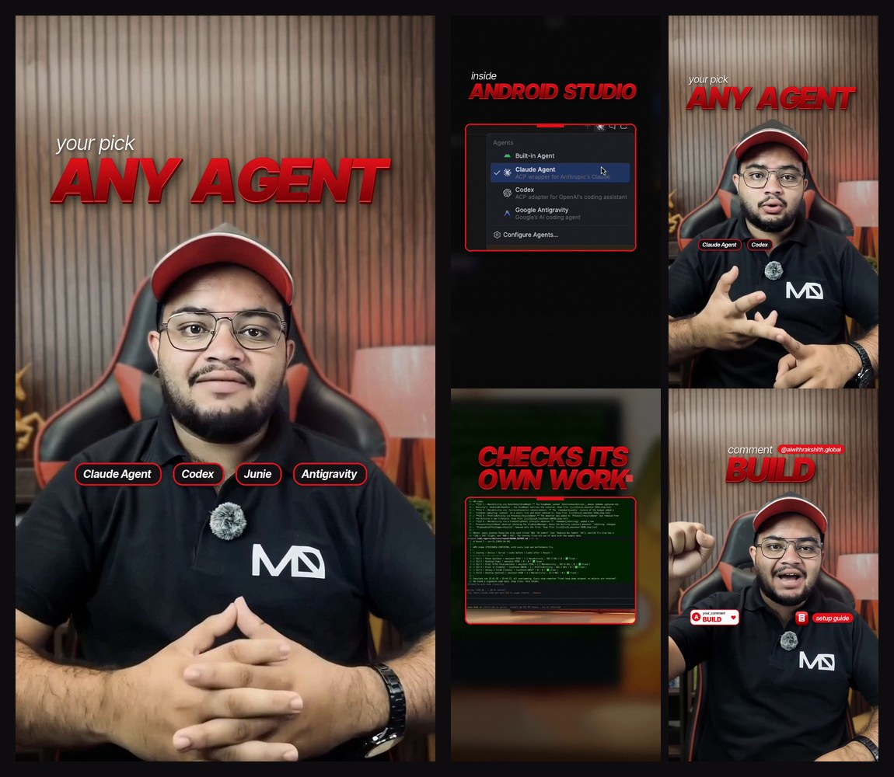

# AI with Rakshith — Kinetic Reel Engine

> **Private.** House-style editing system for **@AIwithRakshith** (Kannada) and **aiwithrakshith.global** (English).
> Rakshith uploads one raw talking-head video (Kannada or English); any capable LLM agent with a shell and this repo
> turns it into a finished **1080×1920, 60 fps** Instagram Reel.



The style is "kinetic type behind the head": giant red 3D words type on *behind* Rakshith while his real room stays
in the background. On top of that come pixel-block glitches, neon squiggle streaks, halftone ring bursts,
red-framed screen cutaways, a chest row of tiles/pills, synced captions, a topic-matched music bed and an SFX on
every visual event. Everything stays inside the Instagram safe zone and nothing ever covers his face.

---

## Sample videos

| Video | What it shows |
|---|---|
| [`samples/day4_android_studio_byoa_60fps_preview.mp4`](samples/day4_android_studio_byoa_60fps_preview.mp4) | Day 4 reel built with this engine: English, 1080×1920 **60 fps**, 40 s, safe-zone layout v3 |
| [`samples/sample_reel_chatgpt_gif_update.mp4`](samples/sample_reel_chatgpt_gif_update.mp4) | Sample reel from Rakshith ("ChatGPT GIF update", 26.5 s) |

These are compressed web previews so they fit in git. Full-quality masters (134–138 MB) are kept in Drive, not in the repo.

Every frame of the Day 4 reel at 1.5 fps, with the Instagram safe box drawn in green:


---

## What's inside

```
aiwithrakshith-reel-engine/
├── README.md                     ← you are here
├── AGENTS.md                     ← instructions for ANY coding agent (Codex, Cursor, Gemini CLI, Copilot, Aider…)
├── CLAUDE.md                     ← pointer for Claude Code / Claude
├── skill/aiwithrakshith-kinetic-reel-editor/SKILL.md   ← the full editing rulebook (v3) — the source of truth
├── prompts/universal_system_prompt.md                  ← paste into ChatGPT / Gemini / Claude / any chat LLM
├── engine/                       ← reusable Python engine (NumPy / OpenCV / Pillow + ffmpeg)
├── examples/
│   ├── kling40/                  ← approved Kling 4.0 Kannada reel timeline (v1 layout)
│   └── day4_android_studio/      ← approved Day 4 English reel (v3 safe-zone layout, 30 + 60 fps renders) + facts + post text
├── samples/                      ← compressed sample reels (web previews)
├── tools/safe_zone_check.py      ← Instagram safe-zone audit sheets for any reel
├── docs/                         ← layout notes and change history
└── requirements.txt
```

### Engine files (`engine/`)
| File | What it does |
|---|---|
| `fx.py` | Graphics library: 3D italic type-on (1 frame/letter), labels, pills, cards, pixel blocks, neon streak, halftone rings, smear, swoosh, negative/magenta flashes, RGB ghost, icons, grain |
| `islands.py` | Speech islands (source seconds) snapped outward to whole frames; source ↔ reel time maps |
| `whisper_islands.py`, `words.py` | Whisper word timings → onset-snapped `words_final.json` |
| `cut_vo.py` | Tightened voice-over (islands butted, 20 ms crossfades, timing exact) |
| `matte.py`, `export_matte.py` | RobustVideoMatting resnet50 (ONNX, CPU) person matte on the tightened timeline |
| `chair_mask.py`, `subject.py` | Gaming-chair mask from the red piping; person + chair, wood-fringe removal, 1 px choke |
| `cap_patch.py`, `cap_logo_fix.py` | Repairs AI cap artifacts (crown colour flips, white logo growth) |
| `audio.py` | Synthesised SFX, music re-sequenced on bar lines with drop-outs, VO chain, sidechain duck |
| `master.py` | −14 LUFS integrated, true-peak limiter (ceiling −2.9 dBTP before AAC) |

The render script (timeline) is per reel. Copy `examples/day4_android_studio/render_day4.py` (current layout, with `stack()`,
`chest_row()`, `ctile()` and the TLOG completion audit) and replace the segment blocks for the new video.

---

## The flow (every reel)


The full written guide for editors and agents is [`docs/WORKFLOW_GUIDE.md`](docs/WORKFLOW_GUIDE.md).

```
1 Upload raw video (KN / EN)
   → 2 Understand: language, transcript, translation, word timings, silences, artifacts
   → 3 Research + fact-check on official sources  → facts.md
   → 4 Gather B-roll (own → official media → licensed stock), topic-matched music, SFX
   → 5 Plan EDL: every keyword / caption / cutaway / device / SFX on its spoken word
   → 6 Build graphics, captions, audio
   → 7 Preview ~15 key frames with the safe-zone overlay
   → 8 Audit loop at ≥ 12 fps: safe zone, face, timing, captions, facts, audio → fix → re-render → re-audit
   → 9 Deliver 60 fps HD MP4 + cover + SRT + post text + facts + credits + QC report
```

### Language rules
| Raw video | Top headline | Captions |
|---|---|---|
| **English** | English | English, word-synced |
| **Kannada** | **Kanglish**: small Kannada label + big English keyword (`Codex ಈಗ` / **ANDROID STUDIO**) | English translation, phrase-synced to his lips |

### Instagram Reels safe zone (1080×1920)
Every text, caption, card, pill, icon, screen window and effect stays inside **x 65–960, y 270–1250**.

| Edge | Keep clear | Why |
|---|---|---|
| Top | 270 px | status bar, Reels title, camera icon |
| Bottom | 670 px | username, follow, caption, audio ticker |
| Left | 65 px | screen edge |
| Right | 120 px (+ action rail lower 40 %) | like / comment / share / save |

Check any reel:
```bash
python3 tools/safe_zone_check.py final_reel.mp4 --fps 12 --out qc/
```
This draws the green safe box, red margins and the cyan 3:4 profile-grid crop on every frame at 12 fps.

### Hard rules (short version — full list in `SKILL.md`)
- Keep his real room as the background. Never alter his voice; only cut silences.
- **No AI generation** (video/image/music/voice). Use his B-roll, official media and licensed stock only.
- Nothing over his face. Text types at 1 frame/letter and is fully typed ≥ 0.25 s before any cut.
- Every on-screen fact is verified on an official source. Licensed music only, credits in the caption, private data blurred.
- Music under the voice, −14 LUFS master, an SFX on every graphic, hard-button ending.

---

## Using it with any LLM

The rulebook is plain Markdown and the engine is plain Python + ffmpeg, so no single vendor is required.

| You are using | Do this |
|---|---|
| **Claude** (claude.ai skill, Claude Code) | Install `skill/aiwithrakshith-kinetic-reel-editor/SKILL.md` as a skill, or open the repo in Claude Code (reads `CLAUDE.md`). |
| **OpenAI Codex / ChatGPT agent, Cursor, GitHub Copilot agent, Gemini CLI, Aider, Windsurf, Cline** | Open the repo. Agents read `AGENTS.md`, which points to `SKILL.md` and the engine. |
| **Chat-only LLMs** (ChatGPT, Gemini, DeepSeek, Grok, Mistral, Llama… without a shell) | Paste `prompts/universal_system_prompt.md` as the system/custom instructions and attach `SKILL.md`. The model plans the EDL, captions, facts and post text; run the engine locally to render. |

**Agent capabilities needed for a full render:** a Linux/macOS shell with Python 3.10+ and ffmpeg, about 8 GB RAM,
web search/fetch for research, and file upload/download. A GPU isn't needed (matting runs on CPU, ~0.35 s/frame).
Models without these can still produce the plan, the facts, the captions/SRT and the post copy.

---

## Setup

```bash
git clone https://github.com/rakshithgowdams/aiwithrakshith-reel-engine.git
cd aiwithrakshith-reel-engine
pip install -r requirements.txt            # add --break-system-packages on Debian/Ubuntu system Python
sudo apt-get install -y ffmpeg             # or: brew install ffmpeg

# fonts (OFL)
mkdir -p work/fonts && cd work/fonts
curl -LO "https://raw.githubusercontent.com/google/fonts/main/ofl/intertight/InterTight%5Bwght%5D.ttf"
curl -LO "https://raw.githubusercontent.com/google/fonts/main/ofl/intertight/InterTight-Italic%5Bwght%5D.ttf"
curl -LO "https://raw.githubusercontent.com/google/fonts/main/ofl/notosanskannada/NotoSansKannada%5Bwdth%2Cwght%5D.ttf"
cd ../..

# matting model
curl -L -o work/rvm_resnet50_fp32.onnx \
  https://github.com/PeterL1n/RobustVideoMatting/releases/download/v1.0.0/rvm_resnet50_fp32.onnx
```

> **Paths:** the scripts were written in a cloud workspace and use absolute paths: `/home/claude/work/` for the engine
> and `/home/claude/d4/` for the Day 4 example. Either create those folders (or symlink them to `./work`), or
> search-and-replace the path constants at the top of each script before running.

### Render commands
For a true 60 fps render use `examples/day4_android_studio/render_day4_60.py`. Its frame numbers are 60 fps frames. Every
effect keeps its 30-fps timing, while rings, neon streaks, swooshes, screen push-ins and grain get real in-between frames.
```bash
# test frames first (PNG), look at them
python3 render.py 0 0 test_frames 4,36,100,230,400
# full render in two parallel halves, then concat + mux
python3 render.py 0 1200 part1.mp4 & python3 render.py 1200 2400 part2.mp4; wait
ffmpeg -f concat -safe 0 -i parts.txt -i mix_final.wav -map 0:v -map 1:a \
  -c:v libx264 -profile:v high -r 60 -crf 17 -maxrate 35M -bufsize 70M -preset veryfast \
  -c:a aac -b:a 320k -ar 48000 -movflags +faststart final_reel_60fps.mp4
```

---

## Deliverables per reel
`final_reel_60fps.mp4` · `cover.png` (reads in the 3:4 grid) · `captions.srt` · `instagram_post.txt` · `facts.md` ·
`credits.csv` · `qc_report.md` · QC sheets (contact, join, safe zone) · `vo_tight.wav` · optional no-music version.

## Version history
See `docs/CHANGELOG.md`. Media (videos, mattes, music, frames) is git-ignored: keep it in Drive, not in the repo.

---
© MyDesignNexus / AI with Rakshith. All rights reserved. Private repository, not for redistribution.
Third-party fonts (Inter Tight, Noto Sans Kannada) are SIL OFL; the RobustVideoMatting model is GPL-3.0 (downloaded
separately, not bundled).
