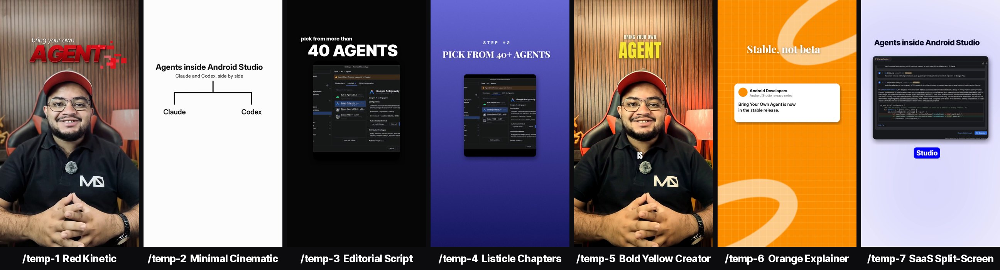
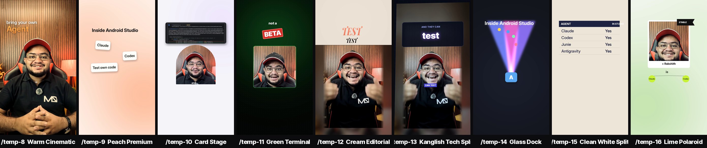
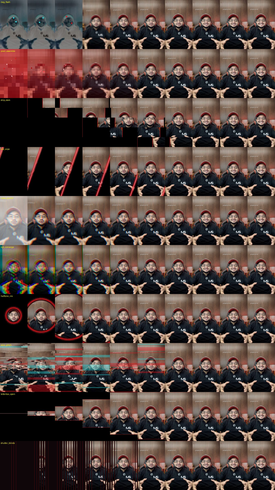
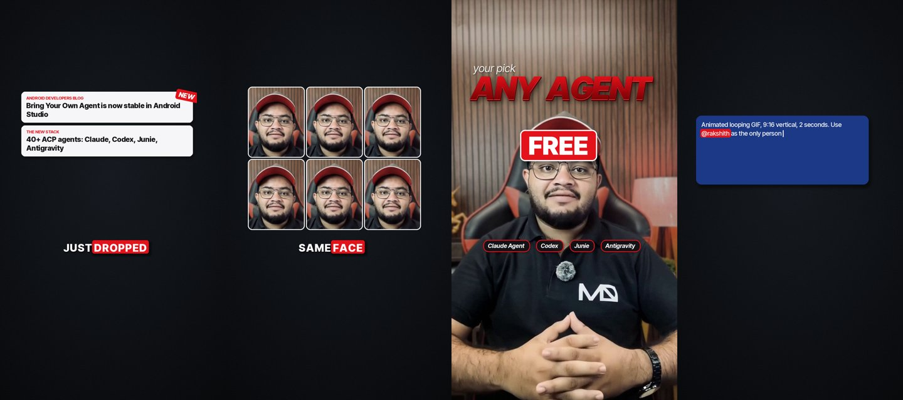
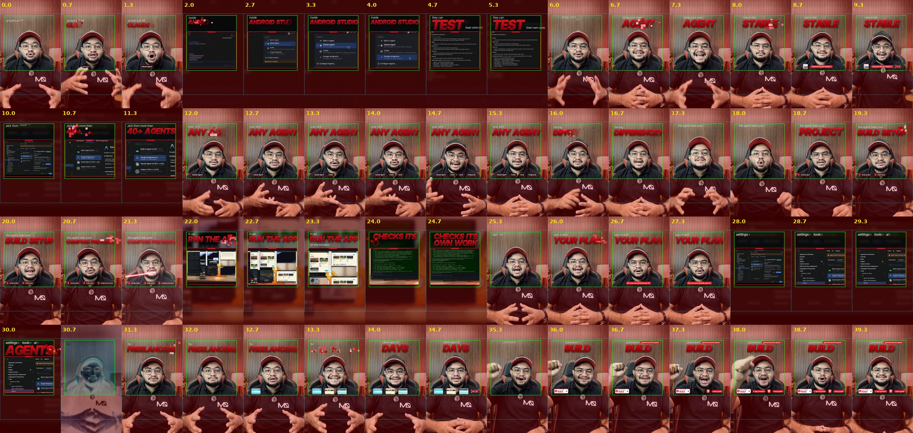
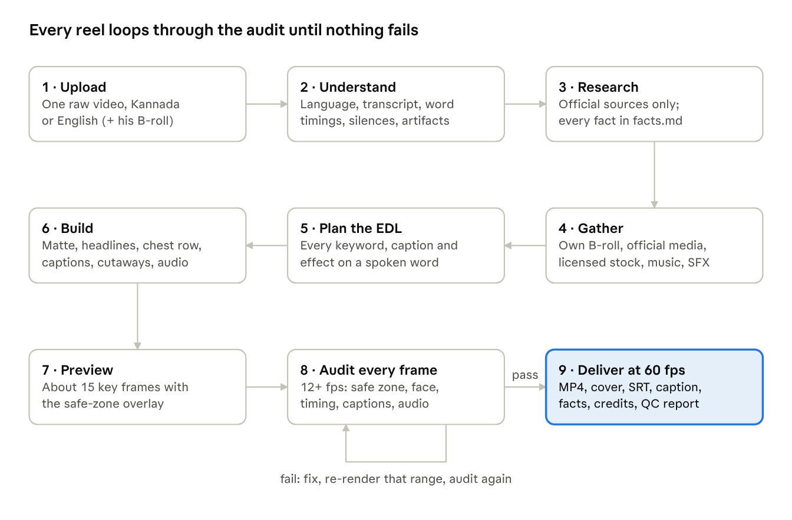

# AI with Rakshith — Kinetic Reel Engine

> **Private.** House-style editing system for **@AIwithRakshith** (Kannada) and **aiwithrakshith.global** (English).
> Rakshith uploads one raw talking-head video (Kannada or English); any capable LLM agent with a shell and this repo
> turns it into a finished **1080×1920, 60 fps HD** Instagram Reel. Every reel is 60 fps, and every reel opens with its own
> **unique hook animation**. Pick one of **16 templates** with `/temp-1` … `/temp-16`; every finished reel is filed in
> Google Drive (`Social Media / month / day`) with its thumbnail, caption Doc and timeline Doc, and logged to `memory/`
> so the next run knows what was already used.


The style is "kinetic type behind the head": giant red 3D words type on *behind* Rakshith while his real room stays
in the background. On top of that come pixel-block glitches, neon squiggle streaks, halftone ring bursts,
red-framed screen cutaways, a chest row of tiles/pills, synced captions, a topic-matched music bed and an SFX on
every visual event. Everything stays inside the Instagram safe zone and nothing ever covers his face.

---

## Quick start: raw video → edit script → reel

```bash
# 1. transcript (Whisper large-v3 word timestamps) + speech islands (silencedetect) → words.json, islands.py
# 2. draft the whole edit script (headlines, captions, hook, cutaways, devices, SFX, music, IG caption, checks)
python3 tools/script_gen.py --words words.json --islands islands.py --brand global --glossary glossary.json --out plan/
python3 tools/script_gen.py ... --interactive          # accept / edit each headline in the terminal
#    Kannada: --phrases phrases.json --lang kn --brand kannada   (reviewed Kannada ↔ English phrase table)
# 3. build render.py from plan/edl.json (template: examples/day4_android_studio/render_day4_60.py), render at 60 fps
# 4. audit the delivery
python3 tools/qc_audit.py final_reel_60fps.mp4 --tlog *.tlog.json --hook <name> --new-reel --srt plan/captions.srt \
        --cover cover.png --sheets qc/
```

Real output on the Day 4 transcript: [`examples/day4_android_studio/plan/plan.md`](examples/day4_android_studio/plan/plan.md).
The gap audit behind these tools: [`docs/AUDIT_2026-11-21.md`](docs/AUDIT_2026-11-21.md) · skill score 8.0/10:
[`docs/SKILL_SCORECARD.md`](docs/SKILL_SCORECARD.md) · full Instagram & Reels rulebook:
[`docs/INSTAGRAM_REELS_GUIDELINES.md`](docs/INSTAGRAM_REELS_GUIDELINES.md).

## 16 templates: `/temp-1` … `/temp-16`




| command | template | style reference | use it for |
|---|---|---|---|
| `/temp-1` | **Red Kinetic** (house) | his Kling 4.0 + Day 4 reels | AI tool launches, news, hype |
| `/temp-2` | **Minimal Cinematic** | @tahacreate | calm tutorials, design/process |
| `/temp-3` | **Editorial Script** | @ahmadjamilofficial1 | mindset, creativity, stories |
| `/temp-4` | **Listicle Chapters** | @weblyfe | "N tips / steps / tools" |
| `/temp-5` | **Bold Yellow Creator** | @artzenmedia | creator tips, app walkthroughs |
| `/temp-6` | **Orange Explainer** | @hammadkhalid8 | business, money, frameworks |
| `/temp-7` | **SaaS Split-Screen** | @marcel_grauu | product / SaaS demos |
| `/temp-8` | **Warm Cinematic** | t-8 (Amazon seller explainer) | expert explainers, calm authority |
| `/temp-9` | **Peach Premium** | t-9 (video-editor tips) | "3 ways / tips" lists, premium tutorials |
| `/temp-10` | **Card Stage** | t-10 (Submagic) | app / AI-tool reviews, launches |
| `/temp-11` | **Green Terminal** | t-11 (Claude Code reel) | money / numbers, dev & agent tools |
| `/temp-12` | **Cream Editorial** | t-12 (OmniRoute reel) | "free / unlimited" reveals, deep dives |
| `/temp-13` | **Kanglish Tech Split** | t-13 (Hinglish tech reel) | **Kannada / Kanglish** tool news |
| `/temp-14` | **Glass Dock** | t-14 (Hinglish AI-tools reel) | "N free AI tools" roundups |
| `/temp-15` | **Clean White Split** | t-15 (all-AI-in-one-app reel) | cost comparisons, tool tours |
| `/temp-16` | **Lime Polaroid** | sezz0283 (agency reel) | agency / founder intros, results |

Each template is a spec in `engine/templates.py` (grade, fonts, palette, headline + caption zones, scene types,
transitions, hook, pace, music) rendered by `engine/template_render.py` (2-7) + `engine/template_styles_b.py` (8-16) at 60 fps;
`/temp-1` uses the house renderer. Split, card, dome and polaroid layouts carry their own face zone, so the guard follows the face
wherever the layout puts it. ASR spellings are fixed before drawing (job `glossary` + hyphen-split merge: Juni → Junie, Anti -Gravity → Antigravity).
Full specs and the alignment grid: [`templates/`](templates/README.md). Claude skill: `skill/aiwithrakshith-reel-templates/`.

```bash
python3 examples/templates_demo/make_jobs.py                                   # demo job files (Day 4 footage)
python3 engine/template_render.py examples/templates_demo/jobs/temp-4.json 0 0 test/ 6,180,600   # test frames
python3 engine/template_render.py examples/templates_demo/jobs/temp-4.json --full reel.mp4        # 60 fps reel
```

**Alignment is enforced, not hoped for.** Every text/card/chip box is checked while rendering: leaving the safe box
(x 65–960, y 270–1250) or touching the face oval stops the render with the time and the element. Layout bands:
HEAD y 280–430 above the cap · FACE (nothing) · CAPTION chin+24 … 1245. Captions appear on the word's first frame.

## Drive delivery + memory

```bash
python3 tools/reel_package.py --video reel.mp4 --job job.json --title "Android Studio BYOA" \
    --caption caption.txt --qc qc_report.md --brand aiwithrakshith.global --out pkg/      # video, thumbnail, caption.html, timeline.html
python3 tools/drive_publish.py pkg/          # Social Media / 2026-11 November / Day 21 - 2026-11-21 / <title>/
python3 tools/memory.py suggest --energy high  # next template + hooks not used in the last 5 reels
```
- Caption and timeline are uploaded as **Google Docs** (HTML → Docs conversion), never .txt. The timeline Doc holds
  every event, the spoken words by second, the rules applied and the QC table.
- `drive_publish.py` finds-or-creates each folder by exact name (no duplicate months/days) and updates files in place.
  Auth once per machine: OAuth desktop client at `~/.reel_engine/credentials.json`, or `REEL_DRIVE_SA=key.json`.
- `memory/CONTEXT.md` (generated) is what every agent reads first: rules, recent reels, blocked hooks, template
  rotation, Rakshith's lessons. `memory/` is committed, so every device and every LLM starts from the same context.

## Hook library: a unique opener for every reel

Eleven hook openers live in [`engine/hooks.py`](engine/hooks.py). A reel never reuses a hook from the last 5 reels;
the rotation is tracked in [`hook_log.md`](skill/aiwithrakshith-kinetic-reel-editor/references/hook_log.md).

| Hook | Energy | Look |
|---|---|---|
| `neg_flash` | high | negative frame + cyan→red blocks, scale-in |
| `pixel_assemble` | high | giant red mosaic resolves into the frame |
| `strip_slam` | high | 5 strips slam in from alternate sides |
| `red_wipe` | medium | diagonal red light band reveals the frame |
| `zoom_punch` | high | 135 % zoom-blur punch with RGB split |
| `rgb_converge` | medium | R/G/B channels fly in and lock |
| `halftone_iris` | calm | iris opens from his face through a red dot ring |
| `slice_glitch` | high | displaced horizontal slices settle |
| `letterbox_open` | calm | black bars part from the face line |
| `shutter_blinds` | medium | 12 vertical blinds snap open |
| `face_punch` | high | extreme close-up on his eyes snaps back, red frame flash |

Watch them on real Day 4 frames: [`samples/hooks_preview_60fps.mp4`](samples/hooks_preview_60fps.mp4). Each row
below is one hook, read left to right:



## Captions, Kanglish text and reference-reel devices

`engine/captions.py` renders karaoke captions or the reference reel's chip style (one keyword on a red box), with SRT export. `engine/kannada_text.py` renders Kannada/Kanglish labels that type on without breaking conjuncts. `engine/ref_devices.py` adds the slate, news stack, face grid, badge and @mention prompt card:



Pick one with `HOOK=<name>` when rendering, or preview them on a new reel with
`python3 tools/hook_preview.py reel.mp4 --face 530,840`.

## Sample videos

| Video | What it shows |
|---|---|
| [`samples/day4_android_studio_byoa_60fps_preview.mp4`](samples/day4_android_studio_byoa_60fps_preview.mp4) | Day 4 reel built with this engine: English, 1080×1920 **60 fps**, 40 s, safe-zone layout v3 |
| [`samples/hooks_preview_60fps.mp4`](samples/hooks_preview_60fps.mp4) | All 10 hook openers on Day 4 frames, 60 fps |
| [`samples/sample_reel_chatgpt_gif_update.mp4`](samples/sample_reel_chatgpt_gif_update.mp4) | Sample reel from Rakshith ("ChatGPT GIF update", 26.5 s) |

These are compressed web previews so they fit in git. Full-quality masters (134–138 MB) are kept in Drive, not in the repo.

Every frame of the Day 4 reel at 1.5 fps, with the Instagram safe box drawn in green:



---

## What's inside

```
reel-engine/
├── README.md                     ← you are here
├── AGENTS.md                     ← instructions for ANY coding agent (Codex, Cursor, Gemini CLI, Copilot, Aider…)
├── CLAUDE.md                     ← pointer for Claude Code / Claude
├── skill/aiwithrakshith-kinetic-reel-editor/
│   ├── SKILL.md                  ← the full editing rulebook (v4): the source of truth
│   └── references/               ← one .md per topic (generated from SKILL.md) + hook_log.md
├── prompts/universal_system_prompt.md                  ← paste into ChatGPT / Gemini / Claude / any chat LLM
├── engine/                       ← reusable Python engine (NumPy / OpenCV / Pillow + ffmpeg)
├── examples/
│   ├── kling40/                  ← approved Kling 4.0 Kannada reel timeline (v1 layout)
│   └── day4_android_studio/      ← approved Day 4 English reel (v3 safe-zone layout, 30 + 60 fps renders) + facts + post text
├── samples/                      ← compressed sample reels (web previews)
├── tools/
│   ├── safe_zone_check.py        ← Instagram safe-zone audit sheets for any reel
│   ├── script_gen.py             ← transcript → full edit script (EDL, captions, hook, checks, IG caption)
│   ├── qc_audit.py               ← one-command delivery audit → qc_report.md
│   ├── hook_preview.py           ← preview every hook on a reel's own frames
│   └── build_skill_refs.py       ← regenerate references/*.md from SKILL.md
├── docs/                         ← layout notes and change history
└── requirements.txt
```

### Engine files (`engine/`)
| File | What it does |
|---|---|
| `fx.py` | Graphics library: 3D italic type-on (1 frame/letter), labels, pills, cards, pixel blocks, neon streak, halftone rings, smear, swoosh, negative/magenta flashes, RGB ghost, icons, grain |
| `islands.py` | Speech islands (source seconds) snapped outward to whole frames; source ↔ reel time maps |
| `whisper_islands.py`, `words.py` | Whisper word timings → onset-snapped `words_final.json` |
| `cut_vo.py` | Tightened voice-over (islands butted, 20 ms crossfades, timing exact) |
| `matte.py`, `export_matte.py` | RobustVideoMatting resnet50 (ONNX, CPU) person matte on the tightened timeline |
| `chair_mask.py`, `subject.py` | Gaming-chair mask from the red piping; person + chair, wood-fringe removal, 1 px choke |
| `cap_patch.py`, `cap_logo_fix.py` | Repairs AI cap artifacts (crown colour flips, white logo growth) |
| `audio.py` | Synthesised SFX, music re-sequenced on bar lines with drop-outs, VO chain, sidechain duck |
| `hooks.py` | 11 unique hook openers (60 fps) + `pick_hook()` rotation helper |
| `face_guard.py` | face-clear guard: restores the face oval after every FX pass; fails on text/component boxes over the face |
| `captions.py` | karaoke / chip captions, smart line breaks, glossary fixes, SRT export, overlap guards |
| `kannada_text.py` | Kannada + Kanglish rendering (RAQM), conjunct-safe type-on, italic shear |
| `ref_devices.py` | slate, news stack + NEW sticker, face grid, badge, @mention prompt card |
| `master.py` | −14 LUFS integrated, true-peak limiter (ceiling −2.9 dBTP before AAC) |

The render script (timeline) is per reel. Copy `examples/day4_android_studio/render_day4.py` (current layout, with `stack()`,
`chest_row()`, `ctile()` and the TLOG completion audit) and replace the segment blocks for the new video.

---

## The flow (every reel)



The full written guide for editors and agents is [`docs/WORKFLOW_GUIDE.md`](docs/WORKFLOW_GUIDE.md).

```
1 Upload raw video (KN / EN)
   → 2 Understand: language, transcript, translation, word timings, silences, artifacts
   → 3 Research + fact-check on official sources  → facts.md
   → 4 Gather B-roll (own → official media → licensed stock), topic-matched music, SFX
   → 5 Plan EDL: every keyword / caption / cutaway / device / SFX on its spoken word
   → 6 Build graphics, captions, audio
   → 7 Preview ~15 key frames with the safe-zone overlay
   → 8 Audit loop at ≥ 12 fps: safe zone, face, timing, captions, facts, audio → fix → re-render → re-audit
   → 9 Deliver 60 fps HD MP4 + cover + SRT + post text + facts + credits + QC report
```

### Language rules
| Raw video | Top headline | Captions |
|---|---|---|
| **English** | English | English, word-synced |
| **Kannada** | **Kanglish**: small Kannada label + big English keyword (`Codex ಈಗ` / **ANDROID STUDIO**) | English translation, phrase-synced to his lips |

### Instagram Reels safe zone (1080×1920)
Every text, caption, card, pill, icon, screen window and effect stays inside **x 65–960, y 270–1250**.

| Edge | Keep clear | Why |
|---|---|---|
| Top | 270 px | status bar, Reels title, camera icon |
| Bottom | 670 px | username, follow, caption, audio ticker |
| Left | 65 px | screen edge |
| Right | 120 px (+ action rail lower 40 %) | like / comment / share / save |

Check any reel:
```bash
python3 tools/safe_zone_check.py final_reel.mp4 --fps 12 --out qc/
```
This draws the green safe box, red margins and the cyan 3:4 profile-grid crop on every frame at 12 fps.

### Hard rules (short version — full list in `SKILL.md`)
- **Face-clear:** no text layer, component layer (card, pill, badge, sticker, window) or effect layer (streak, ring,
  swoosh, glitch block) on his face. `engine/face_guard.py` makes effects pass behind the face and fails the render if
  a text or component box touches it.
- Keep his real room as the background. Never alter his voice; only cut silences.
- **No AI generation** (video/image/music/voice). Use his B-roll, official media and licensed stock only.
- Nothing over his face. Text types at 1 frame/letter and is fully typed ≥ 0.25 s before any cut.
- Every on-screen fact is verified on an official source. Licensed music only, credits in the caption, private data blurred.
- Music under the voice, −14 LUFS master, an SFX on every graphic, hard-button ending.

---

## Using it with any LLM

The rulebook is plain Markdown and the engine is plain Python + ffmpeg, so no single vendor is required.
Every agent reads `memory/CONTEXT.md` first (recent reels, blocked hooks, lessons).

| You are using | Do this |
|---|---|
| **Claude** (claude.ai skill, Claude Code) | Install `skill/aiwithrakshith-kinetic-reel-editor/SKILL.md` and `skill/aiwithrakshith-reel-templates/SKILL.md` (the `/temp-N` router) as skills, or open the repo in Claude Code (reads `CLAUDE.md`). |
| **OpenAI Codex / ChatGPT agent, Cursor, GitHub Copilot agent, Gemini CLI, Aider, Windsurf, Cline** | Open the repo. Agents read `AGENTS.md`, which points to `SKILL.md` and the engine. |
| **Chat-only LLMs** (ChatGPT, Gemini, DeepSeek, Grok, Mistral, Llama… without a shell) | Paste `prompts/universal_system_prompt.md` as the system/custom instructions and attach `SKILL.md`. The model plans the EDL, captions, facts and post text; run the engine locally to render. |

**Agent capabilities needed for a full render:** a Linux/macOS shell with Python 3.10+ and ffmpeg, about 8 GB RAM,
web search/fetch for research, and file upload/download. A GPU isn't needed (matting runs on CPU, ~0.35 s/frame).
Models without these can still produce the plan, the facts, the captions/SRT and the post copy.

---

## Setup

```bash
git clone https://github.com/rakshithgowdams/reel-engine.git
cd reel-engine
./setup.sh              # pip deps, 11 OFL fonts, RVM matte model, then tools/doctor.py (must print READY)
./setup.sh --no-model   # templates 2-7 only (no matting needed)
```
Needs Python 3.9+ and ffmpeg with libx264 (`apt install ffmpeg` / `brew install ffmpeg`). Works on Linux, macOS and WSL.

> **Paths:** every path comes from `engine/paths.py`. Defaults live inside the repo (`work/`, `work/fonts`,
> `work/models`); override with `REEL_WORK`, `REEL_FONTS`, `REEL_MODELS`, `REEL_D4` (Day 4 example media) or
> `REEL_REEL_DIR` (the current reel's folder for the house-style scripts). Media is never committed: put the raw video and
> B-roll in `work/<reel>/` on each machine.

### Render commands
Every reel renders at 60 fps from the template `examples/day4_android_studio/render_day4_60.py`, with the hook set by `HOOK=<name>`. Its frame numbers are 60 fps frames. Every
effect keeps its 30-fps timing, while rings, neon streaks, swooshes, screen push-ins and grain get real in-between frames.
```bash
# test frames first (PNG), look at them
HOOK=pixel_assemble python3 render.py 0 0 test_frames 0,8,72,200,460
# full render in two parallel halves (60 fps frame numbers), then concat + mux
HOOK=pixel_assemble python3 render.py 0 1202 part1.mp4 & HOOK=pixel_assemble python3 render.py 1202 99999 part2.mp4; wait
ffmpeg -f concat -safe 0 -i parts.txt -i mix_final.wav -map 0:v -map 1:a \
  -c:v libx264 -profile:v high -r 60 -crf 17 -maxrate 35M -bufsize 70M -preset veryfast \
  -c:a aac -b:a 320k -ar 48000 -movflags +faststart final_reel_60fps.mp4
```

---

## Deliverables per reel
`final_reel_60fps.mp4` · `cover.png` (reads in the 3:4 grid) · `captions.srt` · `instagram_post.txt` · `facts.md` ·
`credits.csv` · `qc_report.md` · QC sheets (contact, join, safe zone) · `vo_tight.wav` · optional no-music version.

## Version history
See `docs/CHANGELOG.md`. Media (videos, mattes, music, frames) is git-ignored: keep it in Drive, not in the repo.

---
© MyDesignNexus / AI with Rakshith. All rights reserved. Private repository, not for redistribution.
Third-party fonts (Inter Tight, Noto Sans Kannada) are SIL OFL; the RobustVideoMatting model is GPL-3.0 (downloaded
separately, not bundled).
