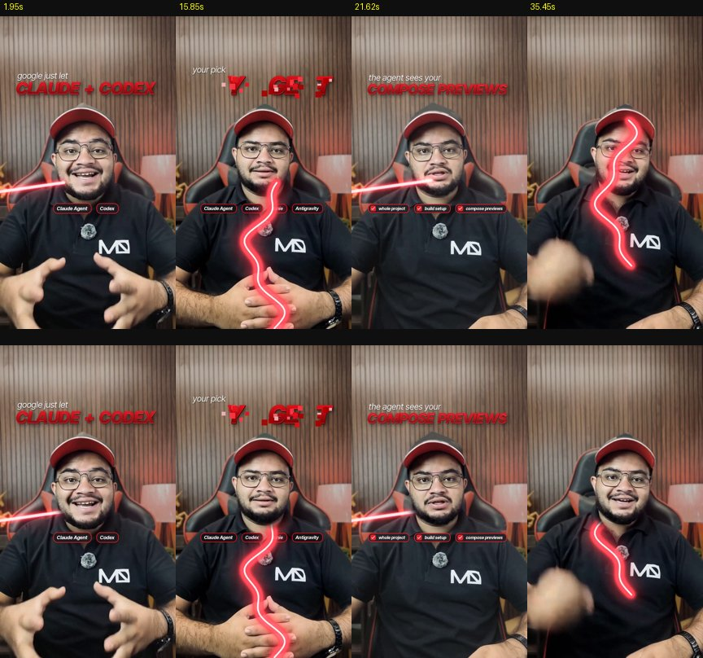

# Instagram & Reels guidelines for AI with Rakshith reels (checked 21 Nov 2026)

Hand-maintained reference for the kinetic reel editor. Re-check the sources when Instagram changes its app or
policies. Every rule here applies to every reel, in Kannada or English.

---

## 1. Face-clear rule (house rule, highest priority)

**Nothing is layered on Rakshith's face.**
- **No text layers:** headline, small label, caption, chip caption, handle pill, CTA text.
- **No component layers:** cards, tiles, pills, badges ("FREE"), stickers ("NEW"), icons, screen windows, prompt
  cards, comment cards.
- **No edit / effect layers:** neon streaks, halftone rings, swooshes, pixel / glitch blocks, marker bars, light
  blooms, grain spots, B-roll picture-in-picture.

How it's enforced:
- The face zone is an oval over his head, measured over ALL frames (min cap-top to max chin, ear to ear) plus 24 px.
- **Code:** `engine/face_guard.py`.
  - `protect_face()` restores the face oval after every overlay FX pass, so effects pass *behind* his face.
  - `FaceZone.check()` fails the render if a text or component box touches the zone.
- **Text:** headlines go above the cap, the chest row and captions below the chin, and tiles never sit beside the
  head.
- **Only exception:** whole-frame transitions that transform the entire picture for ≤ 0.2 s. These are the hook
  opener, negative flash, RGB/magenta ghost, vertical smear and radial blur. They are a cut, not a layer on him.
- **QC:** look at the face on every contact-sheet frame (≥ 12 fps). Any layer on the face is a fail.

## 2. Format and file specs

| Item | Use | Why |
|---|---|---|
| Canvas | 1080 × 1920, 9:16 | Full-screen vertical; Instagram's recommendation tips ask for high-resolution 9:16 |
| Codec | H.264 High + AAC, MP4, +faststart | Most compatible upload |
| Frame rate | **60 fps** (house rule) | Instagram accepts 23–60 fps; 30 is the common default and 60 roughly doubles file size |
| Bitrate / size | CRF 17, VBV 35 Mbps; keep files < 300 MB (limit 4 GB) | Day 4 at 60 fps = 134 MB |
| Loudness | −14 LUFS, ≤ −1 dBTP | Avoids platform limiting and clipping after AAC |
| Cover | 1080 × 1920; headline + face inside the 3:4 grid crop (y 240–1680) | The profile grid shows a 3:4 crop |
| Length | 15–60 s target, 90 s max unless the topic needs it | Reels over 3 min aren't recommended to new audiences (upload limit is 20 min) |

## 3. Safe zone (every readable / persistent element)

Everything readable or persistent stays inside **x 65–960, y 270–1250**.

| Edge | Keep clear | Instagram UI there |
|---|---|---|
| Top | 270 px | status bar, Reels title, camera |
| Bottom | 670 px | username, follow, caption text, audio ticker |
| Left | 65 px | screen edge |
| Right | 120 px + action rail on the lower 40 % | like, comment, share, save, more |

- This box is stricter than every published template (they range from top 210–250 px and bottom 310–420 px), so it
  is safe on all of them.
- Full-bleed backgrounds and transition FX may cross the margins for ≤ 0.2 s; text, cards and windows may not.
- Check with `tools/safe_zone_check.py reel.mp4 --fps 12`.

## 4. What Instagram recommends less (Reels tab, Explore, non-followers)

Instagram says it shows fewer Reels that are muted, blurry or low resolution, have borders, logos or watermarks, or
are mostly covered by text. So:
- Always original audio (his voice) + licensed music. Never silent.
- Always 1080p source and export. No upscaled blurry B-roll, no bordered or letterboxed full-frame clips.
- No other app's watermark (TikTok, CapCut, Edits template marks) and no stock watermark previews.
- **Text coverage:** big type + labels + captions stay under ~35 % of the frame area on talking-head shots. Never a
  full-screen wall of text; screen cutaways show the UI with one headline, not paragraphs.
- Recommendation guidelines also exclude some low-quality content, including contest/giveaway promotion and
  unoriginal repurposed content. Our CTA is a comment-keyword DM offer, never framed as a giveaway.
- Health / finance claims (earnings, "make ₹1 lakh") need evidence or must be left out. Unproven money claims are
  treated as low-quality.

## 5. Originality (2026)

- Instagram's original-content guidelines: add more than low-effort edits (borders, watermarks, speed changes, or
  just crediting the creator). Content copied from another account can lose recommendation eligibility. An account
  becomes eligible again when most of its posts in a rolling 30-day window are original.
- Our rule: his A-roll is always the backbone. Third-party material (official screenshots, demo clips) appears only
  inside our framed windows, with a push-in, our headline and his commentary. It is never shown full-screen and never
  reposted as-is. Check Account Status in the app if reach drops.

## 6. Music and audio

- Only music we hold a licence for (Drive library with a commercial licence, or licensed stock). Never commercial songs.
- If the licence is unclear, export a no-music version and add Instagram's licensed in-app audio instead.
- His voice is never altered (no dubbing, pitch or speed change). Meta AI translation/dubbing is his choice inside the
  app, not part of our edit.

## 7. Hashtags and post caption

- **Maximum 5 hashtags per Reel.** Instagram enforces it from Dec 2025, and caption + comments together still count as
  five.
- Use specific tags (product, topic, brand), not generic ones like `#reels` / `#explore`, which Instagram says won't
  help.
- House format: exactly 4 caption lines (hook · what it is · why it matters · CTA + source credit), then 5 lowercase
  hashtags ending with `#aiwithrakshith`.
- Credit official sources in line 4 ("Screens: Android Developers Blog"). Add "not sponsored" when it isn't paid.

## 8. Labels and disclosure

- **AI info label: REQUIRED** when the reel has photorealistic video or realistic-sounding audio that was digitally
  created or altered. That covers his AI-generated talking head, an AI avatar or an AI voice. Meta says penalties are
  possible if a required label is missing. Turn it on under More options before posting.
- **Paid Partnership label** whenever a brand paid or gave something of value. Never imply a sponsorship that doesn't
  exist (logos are editorial references).

## 9. Privacy, IP and community guidelines

- Blur private people's faces, names, phone numbers, emails, addresses, number plates and chats in any screenshot.
- Trademarks and logos only as editorial reference. No fake UI, fake numbers or fake news cards. Every on-screen fact
  is in `facts.md` with an official source.
- Follow Instagram's Community Guidelines: no misleading claims, no harassment, nothing unsafe.

## 10. Accessibility and captions

- Burn in captions on every reel (English; translated from Kannada for @AIwithRakshith), synced to his lips.
- When captions are burned in, turn Instagram's auto-captions OFF so text doesn't appear twice.
- Captions: one line, ≤ 5 words / 30 chars, high contrast, inside the safe zone, never on the face (§1).

## 11. Posting checklist

1. `qc_report.md` is PASS (`tools/qc_audit.py`), and the face and safe zone were checked by eye on the contact sheets.
2. Cover set (3:4 crop checked). Caption: 4 lines + 5 lowercase hashtags.
3. AI info label ON if the A-roll / voice is AI-generated. Paid Partnership ON only if paid.
4. Instagram auto-captions OFF (captions are burned in). Music licence confirmed or in-app audio used.
5. Not sure between two hooks → publish one as a **Trial Reel** (shown to non-followers first) and keep the winner.
6. Log the hook in `hook_log.md` and the music track in the music log.

## Sources

- help.instagram.com/1525585517644948: Reels shown less (muted, blurry, low resolution, borders/logos/watermarks,
  mostly text)
- help.instagram.com/313829416281232: Recommendation Guidelines (low-quality, contest/giveaway, unoriginal)
- creators.instagram.com/original-content-guidelines and creators.instagram.com/blog/rewarding-original-creators-on-instagram
- creators.instagram.com/blog/instagram-recommendations-eligibility-tips-creators: 9:16 high-resolution, original content
- help.instagram.com/761121959519495 and meta.com/help/artificial-intelligence/1783222608822690: AI labels
- Hashtag limit: socialmediatoday.com (Instagram's statement), businesstoday.in (19 Dec 2025), later.com (Apr 2026)
- Length: buffer.com (Nov 2026), creatorflow.so; specs: socialpilot.co, argil.ai, orlo (23–60 fps)
- Safe-zone variants: aicarousels.com, ignitesocialmedia.com, postplanify.com, adkit.so
