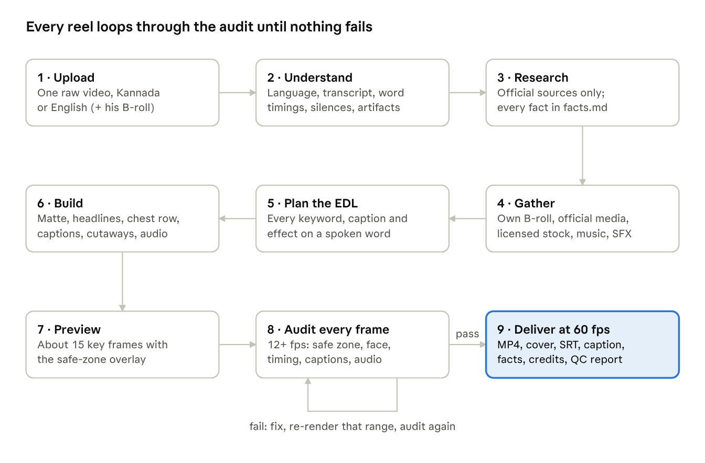

# AI with Rakshith — Reel Editing Workflow Guide

One raw talking-head video in, one finished 1080×1920, 60 fps Instagram Reel out. This is the house process for
@AIwithRakshith (Kannada) and aiwithrakshith.global (English), for human editors and AI agents alike.
Full rules: [`skill/aiwithrakshith-kinetic-reel-editor/SKILL.md`](../skill/aiwithrakshith-kinetic-reel-editor/SKILL.md).

Three rules never bend: everything stays inside the Instagram safe zone, **no text, component or effect layer ever
touches his face** (enforced by `engine/face_guard.py`), and nothing in
the reel is AI-generated. Every reel is also delivered at **60 fps HD** and opens with a **unique hook**.

## Flowchart

Steps 1–7 run once. Step 8 repeats until every check passes, and only then does the reel go out at 60 fps.

## Step by step

1. **Upload.** One raw video (Kannada or English), plus his own B-roll if any.
2. **Understand the video.** Detect the language and transcribe with word timestamps. For Kannada, also translate,
   correcting the English by meaning. Snap keywords to their real onsets and map silences (pauses of 0.35 s or more
   become about 0.22 s). Scan at 10 fps for AI artifacts and fix them.
3. **Research and fact-check.** Use official sources first. Every on-screen fact gets a source in `facts.md`. If the
   voice is slightly off, the screen shows the correct wording.
4. **Gather assets.** B-roll in this order: his own, official product media, then licensed Magnific stock (no AI
   items). Graphics come from stock icons, 3D, mockups, PSDs, templates and fonts. Use a new topic-matched music track
   every video and one SFX per visual event.
5. **Plan the edit (EDL).** Each row: time, spoken word, label, keyword, caption, effect, B-roll, SFX. A new event
   every 0.3–0.5 s, always on a spoken word.
6. **Build.** Matte him out, type headlines behind his head, put one row of items on his chest, then add captions,
   cutaways, effects and the audio mix.
7. **Preview.** Render about 15 key frames with the safe-zone overlay, look at each, fix, then do the full render.
8. **Audit loop.** Check every frame at 12 fps or more. Fix, re-render that range and re-audit until nothing fails.
9. **Deliver.** 60 fps MP4, cover, SRT, Instagram caption, facts, credits, QC report.

## Language rules

| Raw video | Brand | Top headline | Captions | Post caption |
|---|---|---|---|---|
| English | aiwithrakshith.global | English | English, word-synced | English, global hashtags |
| Kannada | @AIwithRakshith | Kanglish: Kannada label + English keyword (`Codex ಈಗ` / **ANDROID STUDIO**) | English, translated and phrase-synced to his lips | Kannada-English mix, Kannada hashtags |

- Headlines are never full sentences. Product names always stay in English spelling.
- Kannada uses Noto Sans Kannada and is revealed per letter cluster, so conjuncts never break.
- Captions are one line of up to 5 words or 30 characters. The spoken word is shown in red. A caption never appears
  early and never covers his face.

## Instagram Reels safe zone (1080×1920)

Every readable element stays inside **x 65–960, y 270–1250**.

| Edge | Keep clear | Instagram UI there |
|---|---|---|
| Top | 270 px (14 %) | Status bar, Reels title, camera |
| Bottom | 670 px (35 %) | Username, follow, caption, audio |
| Left | 65 px (6 %) | Screen edge |
| Right | 120 px + action rail (lower 40 %) | Like, comment, share, save |

- Margins follow Meta's Reels ad guidance. Re-check them when the app's layout changes.
- The profile grid shows a 3:4 crop (y 240–1680), so the cover must read inside it.
- Check any reel with `python3 tools/safe_zone_check.py reel.mp4 --fps 12`.

## Instagram rules checklist

- [ ] Music is licensed for commercial Instagram use. Never commercial songs.
- [ ] Third-party media is official, editorial and credited in the caption.
- [ ] No implied sponsorship. Turn on the Paid Partnership label only for paid posts.
- [ ] Turn on the AI info label if the reel shows AI-generated footage or an AI avatar.
- [ ] Private people's faces, names, numbers, emails, addresses and chats are blurred.
- [ ] Claims are true and match `facts.md`. No clickbait the video doesn't deliver.
- [ ] Comment-to-DM CTAs are fine. Giveaways need written rules.

## Style, timing and sound

- His room stays behind him (darkened 20 %, desaturated 20 %, lightly blurred). Keywords are red #E3121B 3D italic
  Inter Tight. Labels are white italic, 20 px above the word.
- Effects come only from the house library, and every jump cut is hidden by one. Motion is snappy and stepped.
- **Hook:** pick one of the 10 openers in `engine/hooks.py` that wasn't used in the last 5 reels (`hook_log.md`),
  matched to the topic's energy, and log it on delivery.
- Text types at 1 frame per letter and is fully typed at least 0.25 s before any cut.
- Music: news/launch 120–135 BPM trap; tutorial 85–105 lo-fi; story 70–95 cinematic; business 100–118 house.
- The voice always sits on top. Master at −14 LUFS with peaks at or below −1 dBTP. Every graphic has a sound, and the
  reel ends on a hard hit.

## Audit and deliverables

- [ ] 12 fps safe-zone contact sheet clean · [ ] face clear · [ ] headlines typed ≥ 0.25 s before cuts
- [ ] captions synced · [ ] facts match · [ ] jump cuts hidden · [ ] −14 LUFS, ≤ −1 dBTP · [ ] flash open, hard end

| File | What it is |
|---|---|
| `final_reel_60fps.mp4` | 1080×1920, 60 fps, H.264 CRF 17, AAC 320k |
| `cover.png` | Reads inside the 3:4 grid crop |
| `contact.png` | Safe-zone contact sheet |
| `captions.srt` | English captions with timings |
| `instagram_post.txt` | 4-line caption + 5 lowercase hashtags, credits, label reminders |
| `facts.md`, `credits.csv` | Sources and licences |
| `qc_report.md` | Checks, fixes, deviations |

**Instagram caption format:** exactly 4 lines (hook, what it is, why it matters, CTA + source credit), then
5 lowercase hashtags ending with `#aiwithrakshith`.
