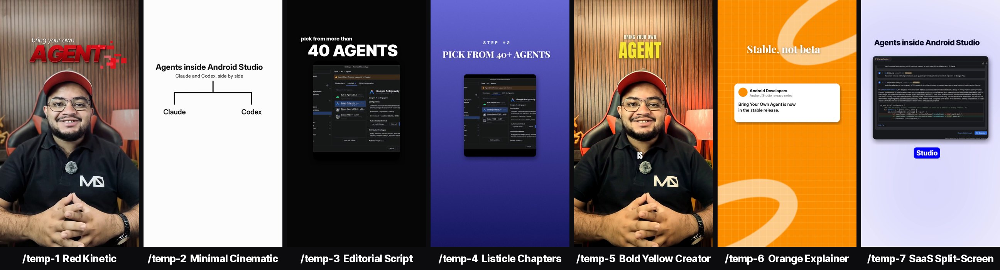
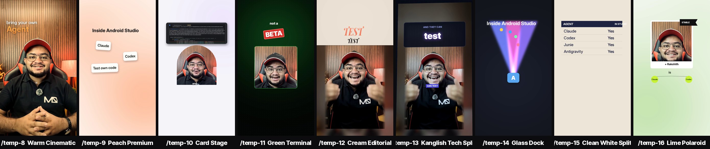

# Reel templates — `/temp-1` … `/temp-16`

Pick a template with `/temp-N` (Claude skill `aiwithrakshith-reel-templates`) or `--template N` in a job file. Specs live in `engine/templates.py`; this folder is generated by `tools/template_docs.py`.

| /temp | name | reference | best for | energy | hook | demo |
|---|---|---|---|---|---|---|
| [/temp-1](temp-1/TEMPLATE.md) | Red Kinetic (house style) | Rakshith: Kling 4.0 + Day 4 reels | AI tool launches, news drops, hype explainers | high | any unused hook (red accent) | `samples/templates/temp-1_preview.mp4` |
| [/temp-2](temp-2/TEMPLATE.md) | Minimal Cinematic | @tahacreate | calm tutorials, design/process explainers, "how to" talks | calm | letterbox_open (white accent) | `samples/templates/temp-2_preview.mp4` |
| [/temp-3](temp-3/TEMPLATE.md) | Editorial Script | @ahmadjamilofficial1 | mindset, creativity, storytelling, motivational takes | medium | face_punch (red accent) | `samples/templates/temp-3_preview.mp4` |
| [/temp-4](temp-4/TEMPLATE.md) | Listicle Chapters | @weblyfe | "N tips/steps/tools" lists, book or course summaries | medium | shutter_blinds (chapter colour) | `samples/templates/temp-4_preview.mp4` |
| [/temp-5](temp-5/TEMPLATE.md) | Bold Yellow Creator | @artzenmedia | creator tips, tool walkthroughs, Canva/app tutorials | high | zoom_punch (yellow accent) | `samples/templates/temp-5_preview.mp4` |
| [/temp-6](temp-6/TEMPLATE.md) | Orange Explainer | @hammadkhalid8 | business, money, book lessons, frameworks | high | strip_slam (orange accent) | `samples/templates/temp-6_preview.mp4` |
| [/temp-7](temp-7/TEMPLATE.md) | SaaS Split-Screen | @marcel_grauu | product demos, SaaS / app features, before-after workflows | medium | halftone_iris (blue accent) | `samples/templates/temp-7_preview.mp4` |
| [/temp-8](temp-8/TEMPLATE.md) | Warm Cinematic | t-8 (Amazon-seller explainer) | expert explainers, "most people never see this" insights, calm authority | medium | rgb_converge (orange accent) | `samples/templates/temp-8_preview.mp4` |
| [/temp-9](temp-9/TEMPLATE.md) | Peach Premium | t-9 (video-editor tips) | "3 ways / 3 tips" lists, creative-tool tips, premium tutorials | medium | pixel_assemble (orange accent) | `samples/templates/temp-9_preview.mp4` |
| [/temp-10](temp-10/TEMPLATE.md) | Card Stage | t-10 (Submagic) | app / AI-tool reviews, "this tool just ..." launches, SaaS features | high | strip_slam (purple accent) | `samples/templates/temp-10_preview.mp4` |
| [/temp-11](temp-11/TEMPLATE.md) | Green Terminal | t-11 (Claude Code reel) | money / numbers stories, dev & AI-agent tools, "I built X" breakdowns | high | slice_glitch (green accent) | `samples/templates/temp-11_preview.mp4` |
| [/temp-12](temp-12/TEMPLATE.md) | Cream Editorial | t-12 (OmniRoute reel) | "free / unlimited" reveals, dev-tool deep dives, documentary tone | medium | shutter_blinds (coral accent) | `samples/templates/temp-12_preview.mp4` |
| [/temp-13](temp-13/TEMPLATE.md) | Kanglish Tech Split | t-13 (Hinglish tech reel) | KANNADA / Kanglish tool news, app walkthroughs, "free alternative" reels | high | zoom_punch (violet accent) | `samples/templates/temp-13_preview.mp4` |
| [/temp-14](temp-14/TEMPLATE.md) | Glass Dock | t-14 (Hinglish AI-tools reel) | "N free AI tools" roundups, app recommendations, creator tool stacks | high | halftone_iris (amber accent) | `samples/templates/temp-14_preview.mp4` |
| [/temp-15](temp-15/TEMPLATE.md) | Clean White Split | t-15 (all-AI-in-one-app reel) | cost comparisons, "replace N subscriptions", tool tours | medium | red_wipe (navy accent) | `samples/templates/temp-15_preview.mp4` |
| [/temp-16](temp-16/TEMPLATE.md) | Lime Polaroid | sezz0283 (agency reel) | agency / founder intros, client results, case studies, service offers | medium | letterbox_open (lime accent) | `samples/templates/temp-16_preview.mp4` |





## Alignment grid (all templates)
```
x: 0 ─ 65 ───────────── safe box ───────────── 960 ─ 1080   (6 columns, 20 px gutter, centre line x = 512)
y 0-270      Instagram top UI          → nothing readable
y 280-430    HEAD band                 → labels / headlines (above the cap)
y cap..chin  FACE band                 → nothing on the face oval (FaceZone + 24 px margin)
y chin+40..1245 CAPTION band           → captions, pills, chips (max 30 chars per line)
y 1250-1920  Instagram bottom UI       → nothing readable
```
Safe box (65, 270, 960, 1250). Every readable box is checked by the renderer (`Reel.check`): leaving the box or touching the face stops the render.
Pace: captions appear on the word's start frame (never early); one visual event every 0.3-0.6 s; every scene change has an SFX.

